# Arquitetura: Folha de Ponto Pessoal v2 (ArchiMate)

Modelo ArchiMate 3.2 da refatoração: um **app 100% offline no celular, em Python
com uv**. Mesmo método do projeto Magalu: **TOGAF ADM** (Preliminar → A → B → C →
D → E-F), com **baseline → target → gap analysis** em cada domínio.

| Arquivo | O que é |
|---|---|
| `folha-de-ponto.archimate` | o modelo; abra no **Archi 5.x** (131 elementos, 261 relações, 18 views) |
| `gera_modelo.py` | gera o modelo. **Edite o script e gere de novo**, não o `.archimate` à mão |
| `exporta_views.sh` | gera os PNGs de `views/` pela linha de comando do Archi |
| `views/*.png` | uma imagem por view |
| [`../casos-de-uso.md`](../casos-de-uso.md) | casos de uso UC01–UC11 e regras RN01–RN10, rastreados no modelo pela propriedade `caso de uso` |

```bash
uv run docs/arquitetura/gera_modelo.py   # valida cada relação contra a tabela do ArchiMate 3.2 do Archi
docs/arquitetura/exporta_views.sh        # atualiza views/*.png
```

## Passo a passo do sistema (comece por aqui)

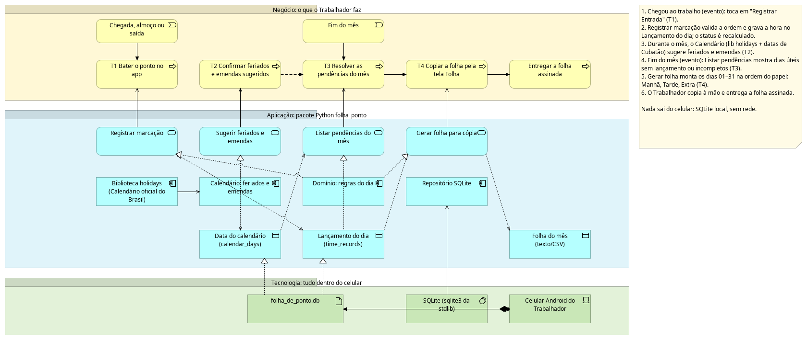

1. **Chegou ao trabalho** (evento): toca em "Registrar Entrada" (*T1 Bater o ponto no app*).
2. *Registrar marcação* valida a ordem e grava a hora no *Lançamento do dia*; o status é recalculado.
3. Durante o mês, o *Calendário* (lib `holidays` + datas de Cubatão) sugere feriados e emendas (*T2*).
4. **Fim do mês** (evento): *Listar pendências* mostra os dias úteis sem lançamento ou incompletos (*T3*).
5. *Gerar folha para cópia* monta os dias 01–31 na ordem do papel: Manhã, Tarde, Extra (*T4*).
6. O Trabalhador copia à mão e entrega a folha assinada.

Nada sai do celular: SQLite local, sem rede.

## 0 · Preliminar: princípios

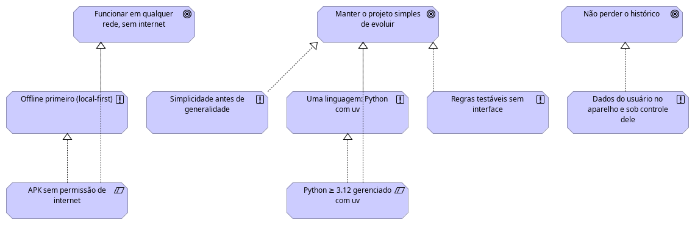

Offline primeiro · Simplicidade antes de generalidade · Uma linguagem (Python com uv) ·
Regras testáveis sem interface · Dados no aparelho e sob controle do usuário.

## A · Vision

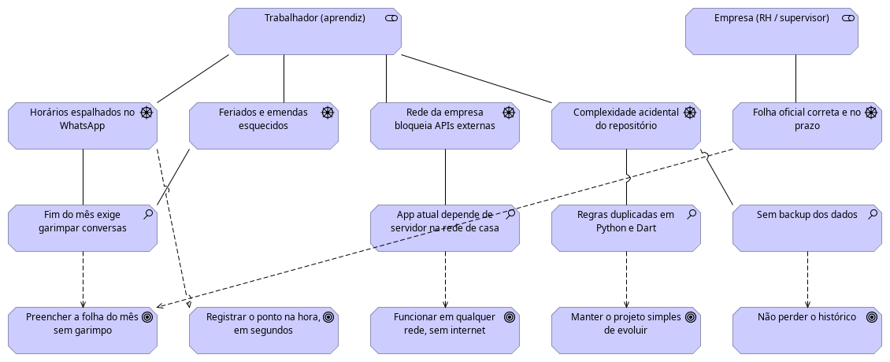
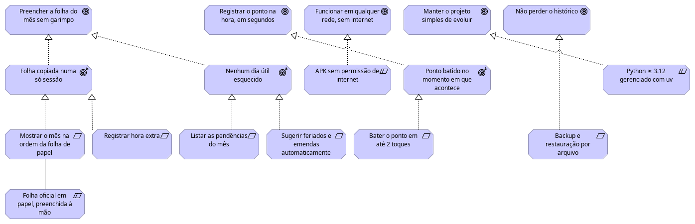
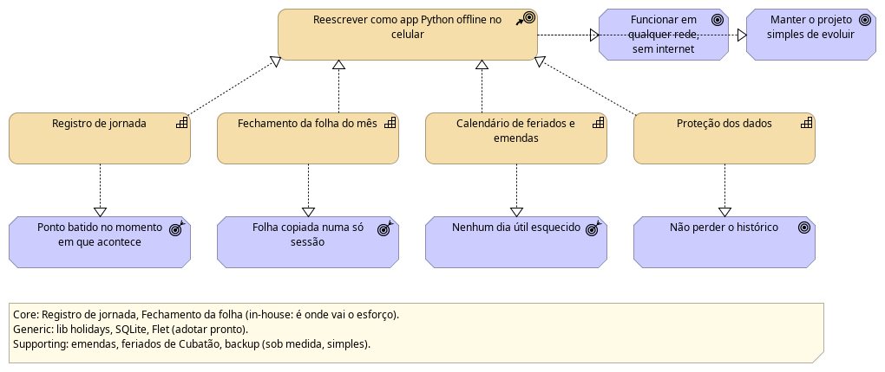

**Subdomínios (DDD):** *Core* = Registro de jornada e Fechamento da folha, onde
vai o esforço. *Generic* = lib `holidays`, SQLite e Flet, adotados prontos.
*Supporting* = emendas, feriados de Cubatão e backup, feitos sob medida.

## B · Business

| Baseline (hoje) | Target |
|---|---|
| 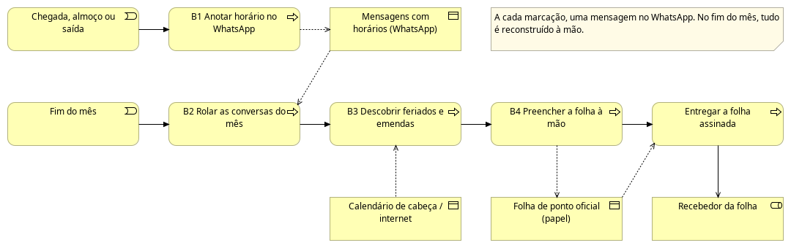 | 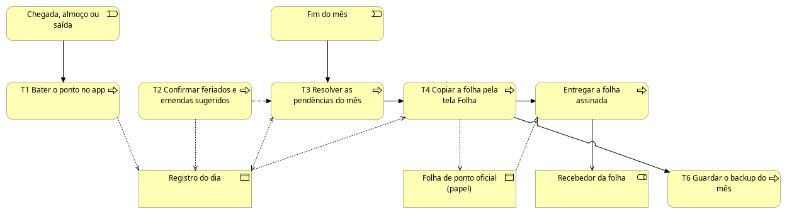 |

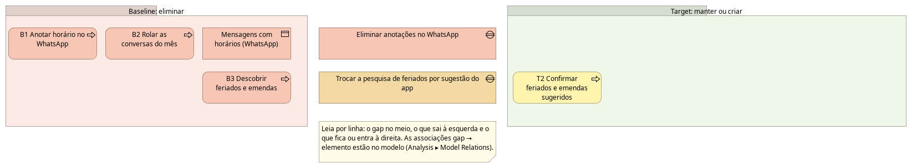

## C · Information Systems (aplicações + dados)

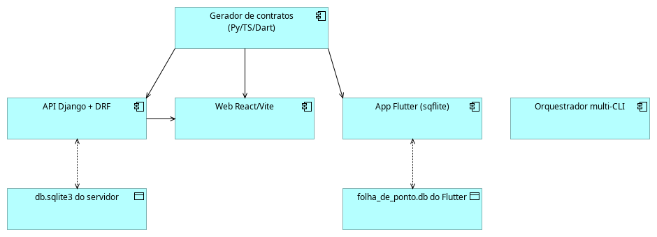
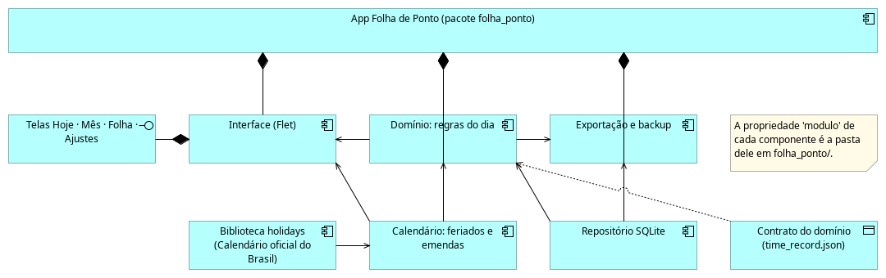
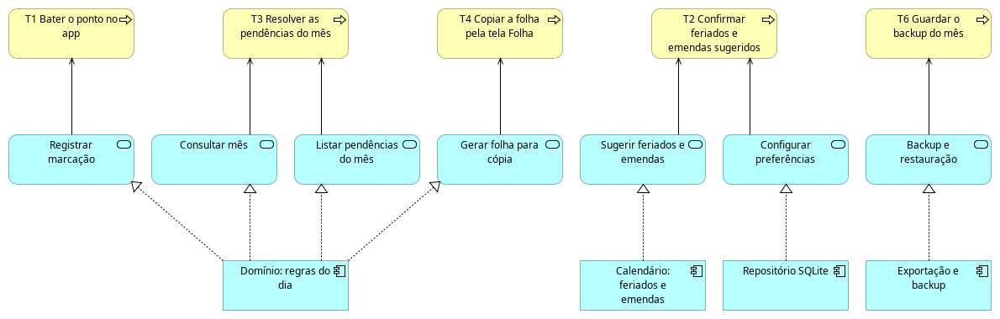
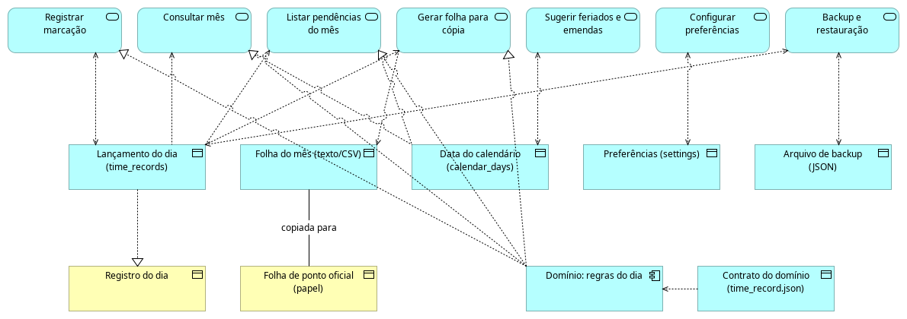
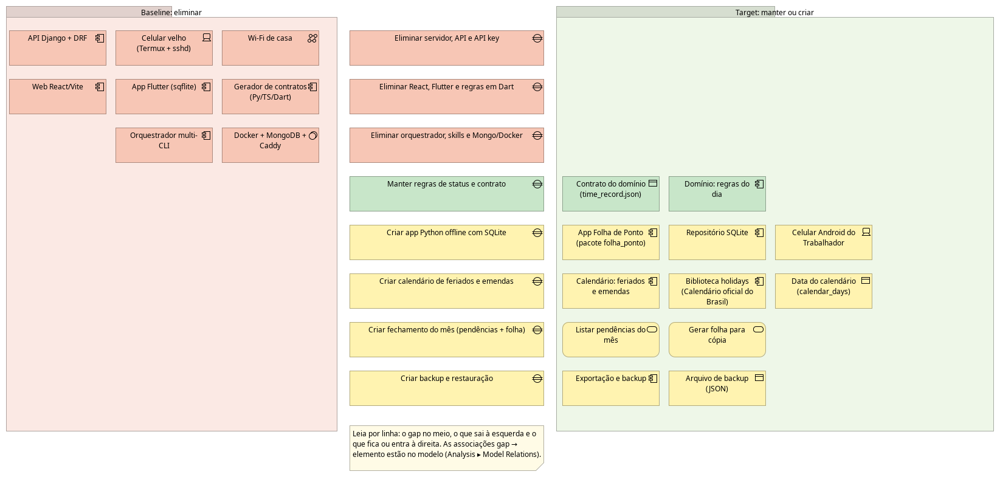

Componentes → módulos do pacote (propriedade `modulo`):

| Componente | Módulo | Responsabilidade |
|---|---|---|
| Interface (Flet) | `folha_ponto/ui/` | telas Hoje · Mês · Folha · Ajustes; só chamam os serviços |
| Domínio: regras do dia | `folha_ponto/dominio/` | status, validação, ordem, horas, pendências, folha do mês (Python puro) |
| Calendário | `folha_ponto/calendario/` | lib `holidays` (BR/SP), regra de emenda, datas manuais |
| Repositório SQLite | `folha_ponto/dados/` | único que fala SQL; migrações por `PRAGMA user_version` |
| Exportação e backup | `folha_ponto/exportacao/` | folha em texto/CSV; backup JSON |

## D · Technology

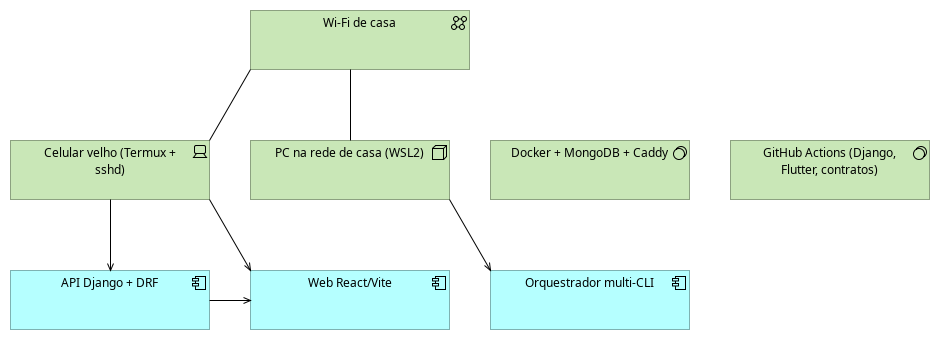
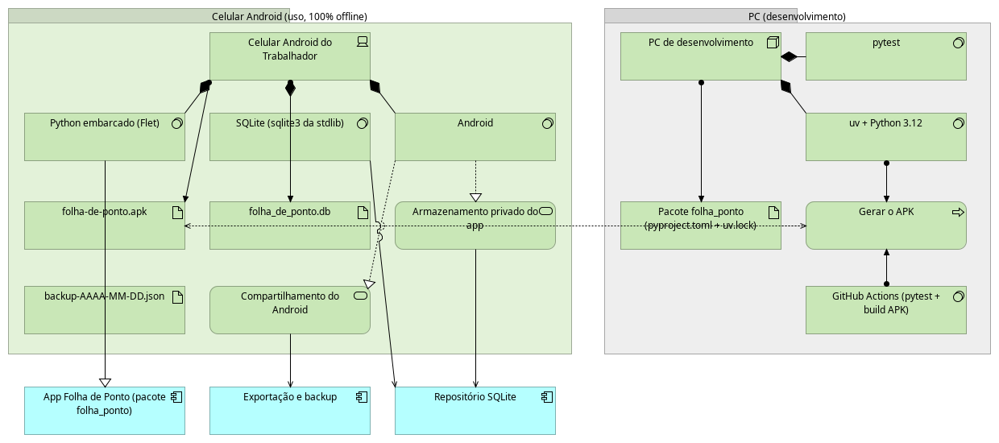

## E-F · Oportunidades e migração

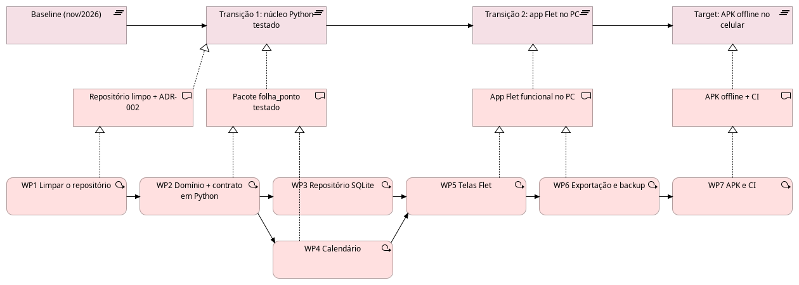
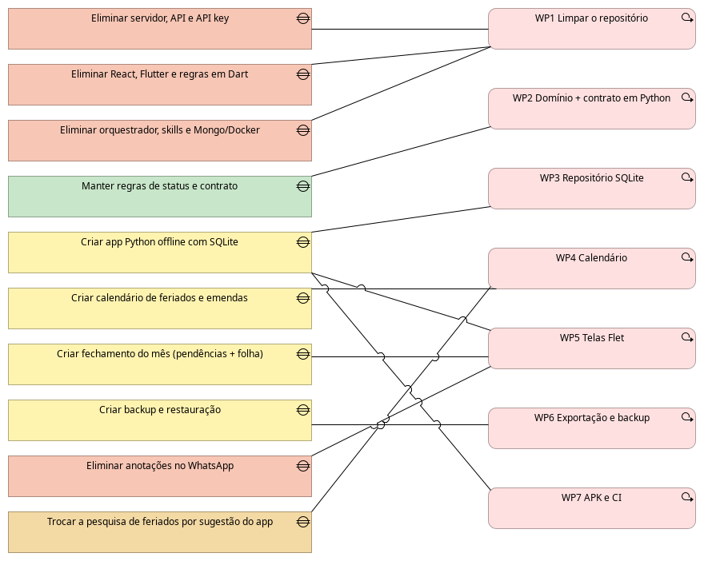

| Platô | Entrega | Pacotes |
|---|---|---|
| Transição 1: núcleo Python testado | repositório limpo + ADR-002; pacote `folha_ponto` com pytest | WP1 limpar · WP2 domínio · WP3 SQLite · WP4 calendário |
| Transição 2: app Flet no PC | app funcional com `uv run` | WP5 telas · WP6 exportação e backup |
| Target: APK offline | APK + CI | WP7 |

Cada platô é uma **arquitetura de transição** que já funciona: dá para parar em
qualquer um e ter algo útil.
